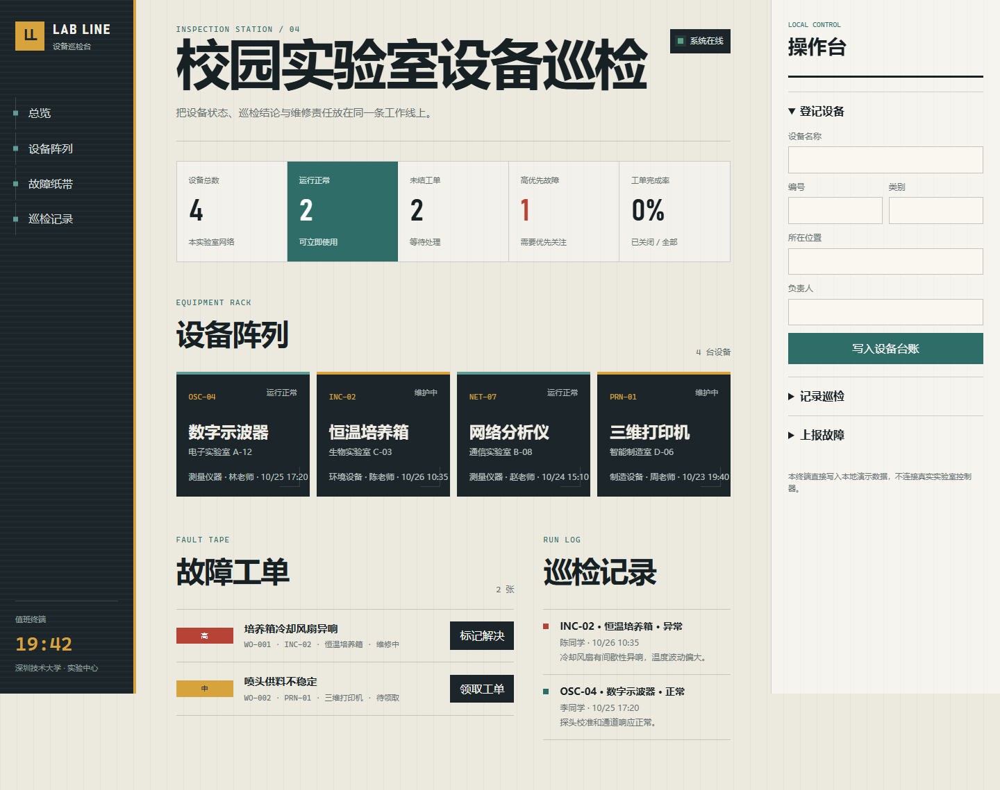

# 测试报告

- 日期：2026-10-27
- Node.js：v24.18.1
- 自动化命令：`npm test`
- 浏览器：Microsoft Edge 无头模式
- 测试数据：临时 JSON 文件和本地演示数据库

## 自动化测试

| 用例 | 结果 |
|---|---|
| 健康检查、种子数据和首页 | PASS |
| 设备必填校验与创建 | PASS |
| 巡检异常记录创建 | PASS |
| 工单创建和非法跳级拦截 | PASS |
| 统计接口 | PASS |

汇总：5 通过，0 失败。

## 浏览器验收

1. 打开 `http://127.0.0.1:3000/`，页面加载设备阵列、工单和巡检记录。
2. 新增“接口一致性测试台”，设备阵列即时刷新。
3. 创建“浏览器端工单交互测试”，工单纸带即时出现。
4. 1440px 桌面视口无横向溢出。
5. 390px 移动视口无横向溢出。

## 界面证据

## 结论

功能、参数校验、状态机和响应式界面均达到毕业设计演示要求。
